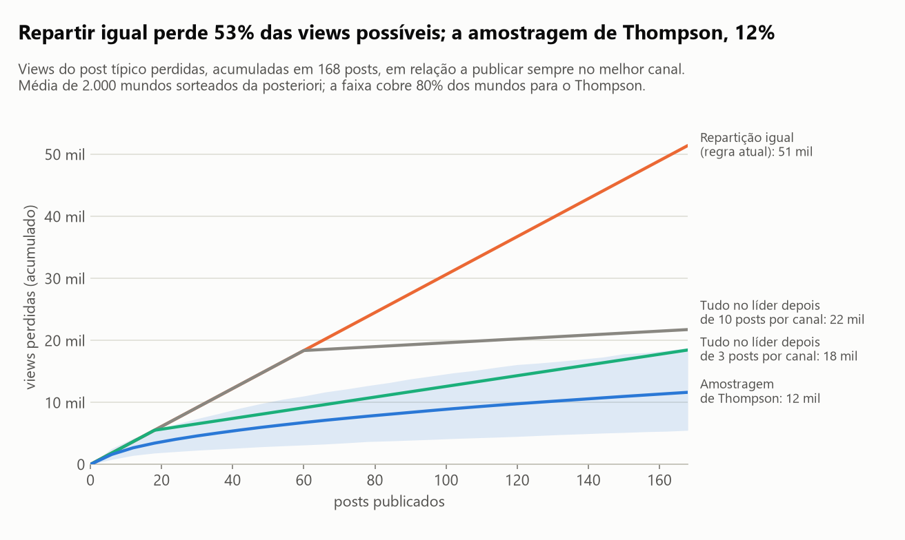
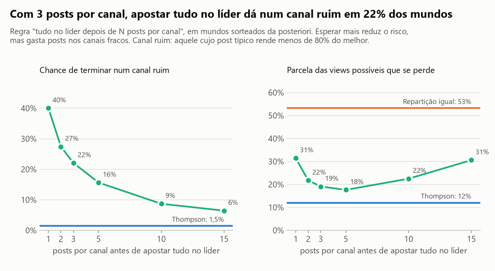
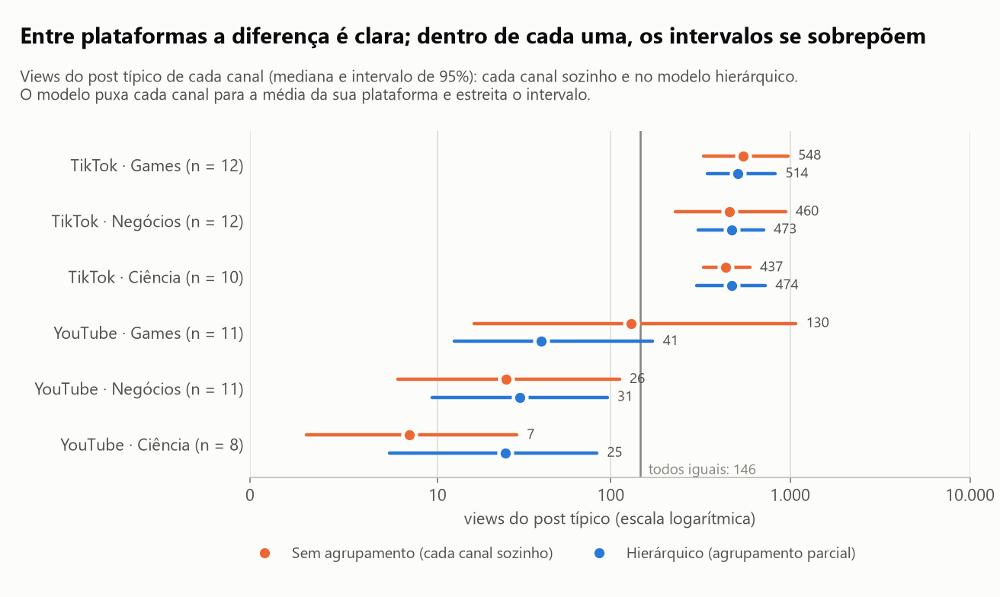
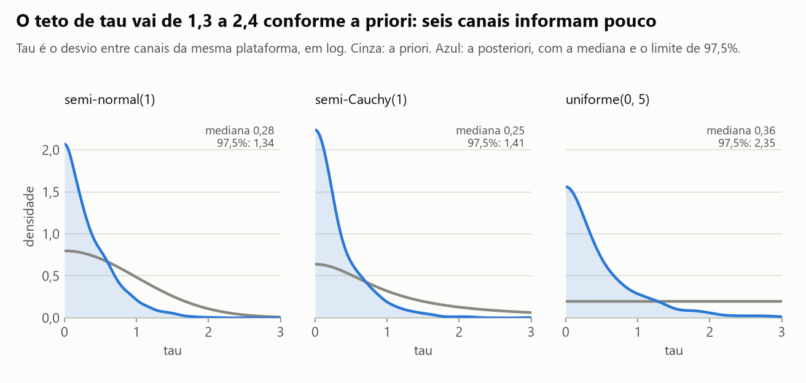
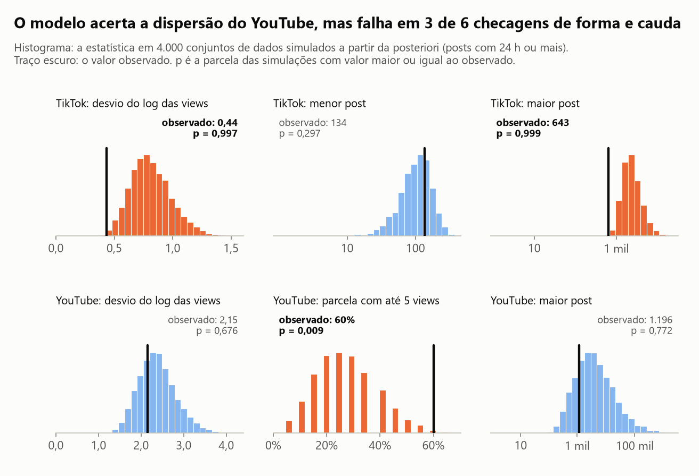
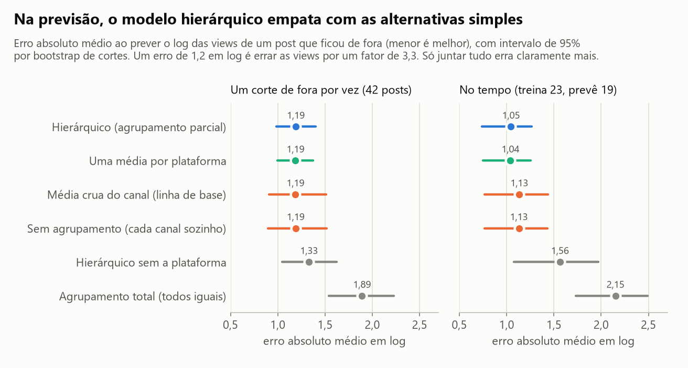

# Com poucos posts em cada canal, em qual canal apostar, e quanto custa decidir cedo demais?

**Na plataforma dá para apostar; no canal, ainda não.** A probabilidade de o melhor canal ser do TikTok passa de
99,9%, e o post típico de lá rende 15 vezes o do YouTube (intervalo de 95%: 4 a 56). Dentro do TikTok, o canal
líder tem só 47% de chance de ser o melhor, e a liderança troca conforme os posts do último dia entram na conta.
Decidir cedo custa caro: apostar tudo no líder depois de 3 posts por canal termina num canal ruim em **22%** dos
mundos simulados, contra **1,5%** da amostragem de Thompson.

Os dados são de uma operação real de cortes de vídeo, que publica em seis canais: três nichos (Games, Negócios,
Ciência) no TikTok e no YouTube. Coleta de 10/11/2026: 64 posts de 35 cortes, de 8 a 12 posts por canal.

## Em 30 segundos

- **A média crua aponta o canal errado.** Por ela, o melhor canal é o YouTube · Games (505 views por post). Só que
  a mediana dele é 158, e a média vem de um dia só: a mediana dos posts de 9/11 é 1.181, contra 26 na véspera. No
  modelo, a chance de ele ser o melhor canal é de 0,07%.
- **O que os dados sustentam é a plataforma.** O post típico do TikTok fica perto de 500 views; o do YouTube, entre
  25 e 41. Dentro de cada plataforma os intervalos se sobrepõem: no TikTok, o melhor canal rende 1,28 vez o pior
  (intervalo de 1,01 a 2,33).
- **O modelo hierárquico não prevê melhor que a alternativa simples.** Ao prever um post que ficou de fora, ele
  erra o mesmo que a média crua do canal e que "uma média por plataforma" (1,19 em log nos três). O que ele entrega
  a mais é a incerteza: o intervalo do YouTube · Games cai de 4,1 para 2,5 em log.
- **Seis canais dizem pouco sobre o quanto os canais diferem.** O limite superior de `tau`, o desvio entre canais,
  vai de 1,3 a 2,4 conforme a priori. A decisão quase não muda com a priori; muda com o tratamento dos posts jovens.
- **Decidir cedo é uma aposta.** Apostar tudo no líder depois de 2 ou 3 posts por canal perde menos que o Thompson
  em mais da metade dos mundos, e perde várias vezes mais nos outros. Na média, Thompson perde 12% das views
  possíveis; a melhor regra de "tudo no líder", 18%; a repartição igual, 53%.
- **O modelo falha em três de seis checagens preditivas**, e a simulação herda essa falha. Está tudo na seção
  "Onde este estudo falha".

## As figuras

### 1. Quanto custa cada regra de alocação



Cada "mundo" é uma amostra da posteriori: um desempenho plausível para cada canal. Em 2.000 mundos, três regras
publicam 168 posts (as quatro semanas seguintes da agenda), um de cada vez, começando do zero. O arrependimento é
o que se deixou de ganhar, em views do post típico, por não publicar sempre no melhor canal daquele mundo.

| Regra | Views possíveis que se perdem | Arrependimento: média | mediana | percentil 90 | Termina num canal ruim |
|---|---|---|---|---|---|
| Repartição igual (regra atual) | 53% | 51.381 | 48.049 | 70.324 | não se aplica |
| Tudo no líder depois de 3 posts por canal | 19% | 18.433 | 8.063 | 55.507 | 22% |
| Tudo no líder depois de 10 posts por canal | 22% | 21.726 | 19.163 | 32.736 | 9% |
| Amostragem de Thompson | 12% | 11.615 | 10.572 | 18.778 | 1,5% |

A amostragem de Thompson perde menos que a repartição igual em todos os 2.000 mundos. Ela põe 92% dos posts no
TikTok e 50% no melhor canal, sem que ninguém precise decidir em que momento parar de testar.

### 2. O custo de decidir cedo (e o de decidir tarde)



| Posts por canal antes de apostar tudo no líder | 1 | 2 | 3 | 5 | 10 | 15 | Thompson |
|---|---|---|---|---|---|---|---|
| Termina num canal ruim | 40% | 27% | 22% | 16% | 9% | 6% | 1,5% |
| Termina na plataforma errada | 26% | 14% | 10% | 4% | 1% | 0,6% | 0% |
| Views possíveis que se perdem | 31% | 22% | 19% | 18% | 22% | 31% | 12% |
| Mundos em que perde menos que o Thompson | 50% | 57% | 54% | 38% | 6% | 1% | |

"Canal ruim" é aquele cujo post típico rende menos de 80% do melhor. A curva da direita tem formato de U: quem
decide com 1 post erra o canal; quem espera 15 posts gasta a maior parte do mês nos canais fracos. E a última linha
da tabela é a parte incômoda: decidir com 2 ou 3 posts dá certo na maioria das vezes. O problema é o tamanho da
perda quando dá errado (percentil 90 de 55.507 views contra 18.778 do Thompson).

### 3. O que se sabe de cada canal



Views do post típico (mediana), com intervalo de 95%:

| Canal | Posts | Média crua de views | Cada canal sozinho | Modelo hierárquico | Chance de ser o melhor |
|---|---|---|---|---|---|
| TikTok · Games | 12 | 447 | 548 (330 a 973) | 514 (345 a 827) | 47% |
| TikTok · Negócios | 12 | 491 | 460 (229 a 944) | 473 (308 a 713) | 26% |
| TikTok · Ciência | 10 | 422 | 437 (331 a 598) | 474 (303 a 729) | 27% |
| YouTube · Games | 11 | 505 | 130 (17 a 1.078) | 41 (13 a 172) | 0,07% |
| YouTube · Negócios | 11 | 157 | 26 (6 a 112) | 31 (9 a 96) | 0% |
| YouTube · Ciência | 8 | 43 | 7 (1 a 29) | 25 (5 a 84) | 0% |

Juntando tudo numa média só, o post típico seria 146 (81 a 266), um número que não descreve nenhuma das duas
plataformas. O modelo hierárquico leva cada canal do YouTube cerca de 80% do caminho até a média da plataforma:
sozinhos, os três pareciam muito diferentes (130, 26 e 7), mas com 8 a 11 posts cada e essa dispersão, a diferença
não se sustenta. No TikTok os canais já estavam juntos.

Se a escolha real for o nicho (o mesmo corte vai para as duas plataformas), a chance de cada nicho ser o melhor é
de 52% para Games, 24% para Negócios e 24% para Ciência. Não é base para cortar nicho nenhum.

### 4. O quanto a priori pesa



`tau` é o desvio entre canais da mesma plataforma, em log. Com seis canais, ele é mal identificado:

| Priori de tau | Mediana da priori | Mediana a posteriori | Limite de 97,5% | Chance de o líder ser o melhor | Post típico do YouTube · Games |
|---|---|---|---|---|---|
| semi-normal(1) (principal) | 0,67 | 0,28 | 1,34 | 47% | 41 |
| semi-Cauchy(1) | 1,00 | 0,25 | 1,41 | 47% | 40 |
| uniforme(0, 5) | 2,50 | 0,36 | 2,35 | 49% | 44 |

Os dados puxam `tau` para baixo nas três, mas não conseguem descartar valores altos: o limite superior quase dobra
da semi-normal para a uniforme. A decisão quase não muda. O que muda a decisão é outra escolha, o tratamento dos
posts com menos de 24 horas:

| Tratamento dos posts jovens | Posts | Líder | Chance do líder | TikTok sobre YouTube | Post típico do YouTube · Games |
|---|---|---|---|---|---|
| De 12 a 24 h: entre o observado e 5 vezes (principal) | 64 | TikTok · Games | 47% | 15 vezes | 41 |
| Só posts com 24 h ou mais | 42 | TikTok · Negócios | 71% | 29 vezes | 13 |
| Todo post jovem como piso, sem teto | 64 | TikTok · Negócios | 55% | 10 vezes | 60 |

### 5. O modelo reproduz os dados?



| Estatística (posts com 24 h ou mais) | Observado | Simulado pelo modelo (mediana e faixa de 95%) | p preditivo |
|---|---|---|---|
| TikTok: desvio do log das views | 0,44 | 0,80 (0,52 a 1,20) | 0,997 |
| TikTok: menor post | 134 | 104 (30 a 235) | 0,30 |
| TikTok: maior post | 643 | 2.224 (984 a 7.736) | 0,999 |
| YouTube: desvio do log das views | 2,15 | 2,34 (1,61 a 3,35) | 0,68 |
| YouTube: parcela com até 5 views | 60% | 25% (5% a 50%) | 0,009 |
| YouTube: maior post | 1.196 | 3.430 (293 a 162.373) | 0,77 |

Em parte. A dispersão e os extremos do YouTube passam. Três checagens falham. No TikTok, os posts maduros batem num
teto perto de 650 views e um único post jovem, que ficou em 6 views, infla o desvio estimado: o modelo espera posts
maiores do que os que existem. No YouTube, 60% dos posts ficam com até 5 views, e uma normal em log não produz esse
amontoado junto com posts de mais de mil. Ajustado só com os posts maduros, o modelo passa nas seis (o menor p é
0,06), ao preço de ignorar o último dia.

### 6. Qual forma de estimar prevê melhor



Na primeira validação, um corte sai por vez (com os posts dele nas duas plataformas) e os 42 posts maduros são
previstos, em 23 rodadas. Na segunda, o modelo treina com os 23 posts maduros mais antigos (3 ou 4 por canal) e
prevê os 19 seguintes. O erro é o erro absoluto médio em log; 1,19 equivale a errar as views por um fator de 3,3.

| Forma de estimar | Um corte de fora: erro | Diferença para o hierárquico (IC 95%) | No tempo: erro | Diferença para o hierárquico (IC 95%) |
|---|---|---|---|---|
| Hierárquico (agrupamento parcial) | 1,19 | | 1,05 | |
| Uma média por plataforma | 1,19 | −0,003 (−0,055 a 0,042) | 1,04 | −0,006 (−0,038 a 0,031) |
| Média crua do canal (linha de base) | 1,19 | −0,004 (−0,193 a 0,198) | 1,13 | 0,088 (−0,139 a 0,304) |
| Sem agrupamento (cada canal sozinho) | 1,19 | −0,002 (−0,197 a 0,205) | 1,13 | 0,084 (−0,138 a 0,293) |
| Hierárquico sem a plataforma | 1,33 | 0,140 (−0,015 a 0,290) | 1,56 | 0,517 (0,158 a 0,770) |
| Agrupamento total (todos iguais) | 1,89 | 0,700 (0,399 a 0,981) | 2,15 | 1,105 (0,783 a 1,343) |

## Como foi feito

1. **Dados.** `data/posts_metricas.csv` e `data/agenda_semanal.csv` são extratos anonimizados da minha operação de
   cortes, copiados do estudo [`nota-viral-cortes`](https://github.com/ghitflux/nota-viral-cortes) por
   `scripts/copiar_dados.py` (o tamanho e o hash de cada arquivo ficam em `data/ORIGEM.json`). Não trazem títulos,
   links nem identificadores de conta; cada corte é um hash curto. Código e extratos sob licença MIT.
2. **Escala e zeros.** A variável é `log(1 + views)`. O 1 resolve os 2 posts com zero views. O "post típico" é a
   mediana das views, `exp(theta) − 1`.
3. **Posts jovens.** Entre duas coletas com 13 horas de intervalo, os 38 posts que já tinham 24 horas cresceram,
   em mediana, 1,00 vez; os 16 com menos de 12 horas, 1,76 vez. Por isso: post com 24 horas ou mais entra com o
   valor observado (42 posts); de 12 a 24 horas, como "entre o observado e 5 vezes o observado" (18 posts; o maior
   crescimento visto depois de 12 horas foi de 3,1 vezes); com menos de 12 horas, só como piso (4 posts). O
   amostrador sorteia o valor final desses posts a cada passo, de uma normal truncada.
4. **Três formas de estimar**, com a mesma verossimilhança: cada canal sozinho, todos iguais e o modelo
   hierárquico, em que a média de cada canal vem de uma normal em torno da média da plataforma, com desvio `tau`, e
   a dispersão dos posts é uma por plataforma.
5. **Amostrador próprio**, em NumPy/SciPy (`src/bayes_canais/hierarquico.py`): Gibbs para as médias, as
   dispersões e os valores censurados, e Metropolis em `log(tau)`, com as médias dos canais integradas para evitar
   o "funil". Quatro cadeias, 16.000 amostras depois do aquecimento. No modelo principal, o maior R-hat é 1,003 e o
   menor tamanho efetivo é 1.725 (`tau`), com 43% de aceitação no Metropolis; entre todos os ajustes, o pior R-hat
   é 1,004.
6. **Testes** (`tests/`): o amostrador é conferido contra a fórmula fechada do modelo normal-normal, contra a
   marginal de `tau` integrada numa grade no exemplo das oito escolas, contra os valores do livro para esse exemplo
   e contra a recuperação de parâmetros em dados simulados, com e sem censura. R-hat e tamanho efetivo são
   conferidos em cadeias independentes, em cadeias AR(1) de resposta conhecida e em cadeias que não misturam.
7. **Sensibilidade** a três prioris de `tau` e a três tratamentos dos posts jovens.
8. **Checagem preditiva a posteriori** com 4.000 conjuntos de dados simulados.
9. **Validação** deixando um corte de fora por vez e separando no tempo, com bootstrap de cortes para o intervalo
   das diferenças.
10. **Decisão**: probabilidade de cada canal ser o melhor e simulação de alocação sequencial
    (`src/bayes_canais/bandit.py`), com a amostragem de Thompson implementada com uma posteriori
    normal-gama-inversa por canal.

## Comparação com a alternativa simples

A alternativa simples é a média crua por canal e a regra "publicar igual em todos".

| O que se compara | Alternativa simples | Método do estudo | Leitura |
|---|---|---|---|
| Canal apontado como o melhor | YouTube · Games (média crua de 505 views; 30% vêm de um post só) | TikTok · Games, com 47% de chance; YouTube · Games tem 0,07% | Discordam. A média crua segue o maior post. |
| Erro ao prever um post, um corte de fora por vez | 1,19 (média crua do canal) | 1,19 (hierárquico) | **Empate**: diferença de −0,004 (−0,193 a 0,198). |
| Erro ao prever um post, no tempo | 1,13 | 1,05 | **Empate**: diferença de 0,088 (−0,139 a 0,304). |
| Log da densidade preditiva, um corte de fora por vez | −1,90 | −1,59 | A favor do hierárquico, sem clareza: diferença de −0,30 (−0,95 a 0,12). |
| Largura do intervalo de 95% do YouTube · Games, em log | 4,12 (canal sozinho) | 2,54 | O ganho do modelo está na incerteza, não no ponto. |
| Views possíveis perdidas em 168 posts | 53% (repartição igual) | 12% (Thompson) | Thompson perde menos em 100% dos mundos simulados. |

Na previsão de ponto, a alternativa simples **empata** com o modelo hierárquico nas duas validações. E uma
alternativa ainda mais simples, "uma média por plataforma", empata no erro (1,19 e 1,04) e fica ligeiramente à
frente no log da densidade preditiva com um corte de fora (diferença de 0,03; intervalo de 0,01 a 0,06). Com esta
amostra, o modelo hierárquico não se justifica pela previsão. Ele se justifica por dar, com a mesma conta, a
incerteza de cada canal e a probabilidade de cada um ser o melhor, que são as entradas da decisão.

## Onde este estudo falha

- **Quatro dias de dados e um canal que mudou de patamar.** A mediana do YouTube · Games foi de 26 views nos posts
  de 8/11 para 1.181 nos de 9/11. O modelo supõe um desempenho fixo por canal e trata isso como dispersão. Se o
  novo patamar persistir, a estimativa de 41 views está errada, e nada aqui consegue distinguir as duas hipóteses.
- **O canal líder dentro do TikTok depende de uma escolha minha.** É o TikTok · Games (47%) no tratamento principal
  e o TikTok · Negócios (71% ou 55%) nos outros dois. O teto de 5 vezes para posts de 12 a 24 horas vem de 42 pares
  de coletas, em que o maior crescimento foi de 3,1 vezes: é uma suposição com pouca base.
- **O modelo não reproduz a forma dos dados.** Três de seis checagens preditivas falham: o teto do TikTok perto de
  650 views e o amontoado de posts do YouTube com até 5 views não cabem numa normal em log. O centro de cada canal
  é comparável; a forma da distribuição, não.
- **O objetivo é o post típico, não a soma de views.** A média que o modelo implica para o YouTube · Games é de
  1.087 views, com intervalo de 212 a 17.677: é quase toda cauda extrapolada. Por esse critério, um canal do
  YouTube seria o melhor com 66% de chance. Com esta amostra a média de views do YouTube não é estimável, e quem
  quer maximizar a soma não tem resposta aqui.
- **`tau` é um só para as duas plataformas e é mal identificado.** Com três canais por plataforma não dá para
  estimar um desvio para cada uma. Quem informa `tau` é o TikTok, medido com mais precisão, e é esse valor que
  decide o quanto os canais do YouTube são encolhidos.
- **Na previsão, o modelo empata com as alternativas simples**, como mostra a seção anterior.
- **A simulação herda tudo isso.** Os mundos são sorteados da própria posteriori, os posts são independentes e os
  canais não mudam com o tempo. E ela trata cada post como uma unidade de esforço transferível, o que não é verdade
  na operação: o mesmo corte vai para as duas plataformas quase de graça. O "custo" da repartição igual só é perda
  real se desse para trocar posts do YouTube por posts a mais no TikTok. A escolha que custa é o nicho, e para ele
  os dados não separam ninguém (52%, 24% e 24%).
- **Decidir cedo ganha na maioria dos mundos.** Apostar tudo no líder depois de 2 posts por canal perde menos que
  o Thompson em 57% deles. A vantagem do Thompson está na média e no pior caso, não em todo caso.
- **Não é experimento.** Horário e ordem de publicação não foram sorteados, e os dois posts de um mesmo corte não
  são independentes: o modelo ignora essa dependência, que só é respeitada na validação e no bootstrap.

## Como rodar

Pré-requisito: [`uv`](https://docs.astral.sh/uv/getting-started/installation/).

```bash
uv sync
uv run python scripts/rodar_analise.py   # regera reports/resultados.json e as figuras (cerca de 1 minuto)
uv run pytest                            # 43 testes
uv run python scripts/montar_notebook.py
uv run jupyter nbconvert --to notebook --execute --inplace analise.ipynb
```

Os extratos já estão em `data/`. Para atualizar com uma coleta mais recente do estudo de origem:
`uv run python scripts/copiar_dados.py "<pasta data/ do nota-viral-cortes>"`.

O notebook [`analise.ipynb`](analise.ipynb) conta a história completa, com as tabelas.

## Como este estudo foi feito

Este estudo foi construído com assistência de IA (Claude Code, da Anthropic), usada como par de programação.
Declaro a divisão do trabalho porque ela importa para quem avalia:

- **Meu:** a operação e os dados (a rede de cortes, os seis canais e a coleta diária de métricas são meus), o
  problema (com poucos posts por canal, onde pôr o esforço de publicação?), a leitura crítica dos resultados e a
  decisão do que publicar e do que declarar como limitação.
- **Com o assistente:** a formulação estatística da pergunta, a escolha do método, a implementação do código, dos
  testes e dos gráficos, e a redação, que revisei.
- **Como conferir:** todo número deste README sai de `reports/resultados.json`, gerado por
  `scripts/rodar_analise.py`. Os testes em `tests/` conferem o amostrador e os diagnósticos contra casos de
  resposta conhecida.

É o mesmo jeito que trabalho nos sistemas que entrego: a IA acelera a implementação, e a responsabilidade pelo que
está escrito aqui é minha.

## Summary (English)

With only 8 to 12 posts per channel, which of six short-video channels (three niches on TikTok and YouTube) should
get the publishing effort, and what does deciding too early cost? Using 64 posts from my own clipping operation, I
compare no pooling, complete pooling and a hierarchical normal model on log views, fitted with a hand-written
Gibbs sampler with a Metropolis step for the between-channel scale (NumPy/SciPy only; R-hat and effective sample
size implemented and tested against known answers, including the eight-schools example). Posts younger than 24
hours enter as censored observations. The platform is clear: the probability that the best channel is on TikTok is
above 99.9%, and a typical TikTok post earns 15 times a YouTube one (95% interval 4 to 56). The channel is not:
the leader has a 47% chance of being the best and changes with how recent posts are handled. In out-of-sample
prediction the hierarchical model ties with the raw channel mean and with a plain per-platform mean; its value is
the uncertainty it provides. In a sequential-allocation simulation over 168 posts, Thompson sampling gives up 12%
of the achievable views against 53% for an equal split, and ends on a bad channel in 1.5% of simulated worlds
against 22% for "go all in on the leader after 3 posts per channel". The model fails three of six posterior
predictive checks, the data span four days, and one channel changed regime within them; all of this is reported.
Code and notebook are in Portuguese.
